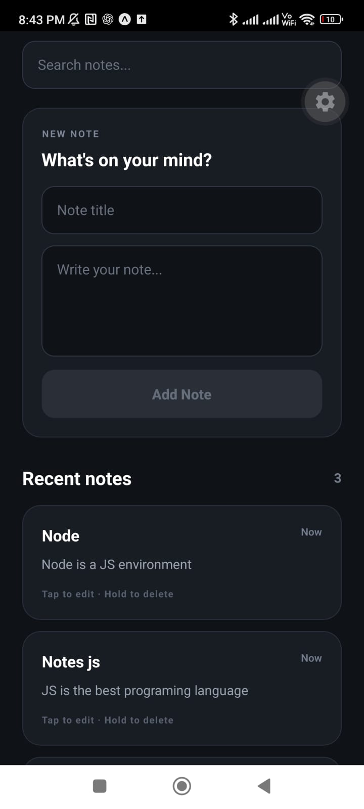
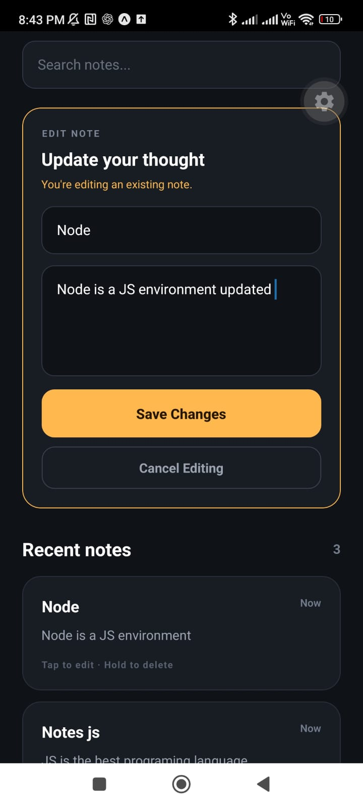

# Jot

Jot is a quick notes mobile app built with React Native, Expo and TypeScript.

It allows users to create, edit, delete and search notes through a simple mobile-first interface.

## Features

- Create notes with title and content
- Edit existing notes
- Delete notes with long press confirmation
- Search by title or content
- Empty search state
- Dynamic note counter
- Multi-line text input
- Mobile keyboard handling
- Safe area support
- Efficient note rendering with FlatList

## Tech Stack

- React Native
- Expo
- React
- TypeScript
- react-native-safe-area-context

## Screenshots

### Notes



### Editing a Note



## What I Practiced

Jot is App 03 of my progressive React Native learning lab.

I practiced:

- `FlatList` for rendering collections
- Controlled `TextInput` components
- Multi-line text input
- CRUD operations with React state
- Immutable state updates
- Derived filtered data
- Search functionality
- Conditional rendering
- Empty states
- `Pressable`
- `onLongPress`
- Native `Alert`
- Keyboard handling
- Safe areas
- Reusable components
- TypeScript models

## CRUD Patterns

The project uses common immutable React patterns.

### Create

```ts
setNotes((currentNotes) => [
  newNote,
  ...currentNotes,
]);
```

### Update

```ts
setNotes((currentNotes) =>
  currentNotes.map((note) =>
    note.id === editingNoteId
      ? {
          ...note,
          title: cleanTitle,
          content: cleanContent,
        }
      : note,
  ),
);
```

### Delete

```ts
setNotes((currentNotes) =>
  currentNotes.filter(
    (note) => note.id !== noteId,
  ),
);
```

## FlatList

Jot uses `FlatList` instead of rendering a collection inside a regular `ScrollView`.

This provides a structure designed specifically for potentially larger mobile lists.

## React Web vs React Native

Concepts reused from React:

- Components
- Props
- `useState`
- Controlled inputs
- Immutable updates
- Derived state
- Conditional rendering
- TypeScript

React Native concepts explored:

- `FlatList`
- `TextInput`
- `Pressable`
- `onPress`
- `onLongPress`
- Native `Alert`
- `KeyboardAvoidingView`
- `Keyboard.dismiss()`
- Safe areas
- Mobile keyboard behavior

## Run Locally

Requirements:

- Node.js 22.19.0
- npm
- Expo Go or an Android development environment

Install dependencies:

```bash
npm install
```

Start the development server:

```bash
npx expo start
```

Then open the project with Expo Go or an Android emulator.

## Validation

The project was validated with:

```bash
npx tsc --noEmit
npx expo-doctor@latest
```

Expo Doctor result:

```text
21/21 checks passed. No issues detected!
```

## About the Lab

Jot is App 03 of a progressive React Native lab focused on learning mobile development fundamentals while building small, usable portfolio projects.

The main focus of this project was working with forms, CRUD operations, FlatList, search and mobile interactions.
